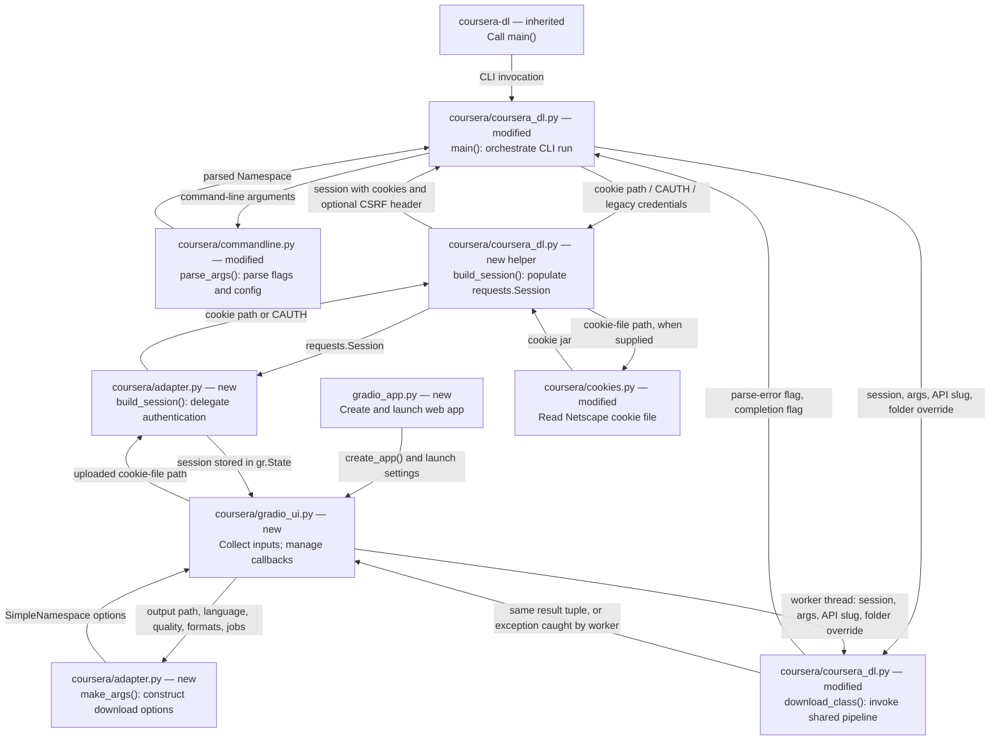
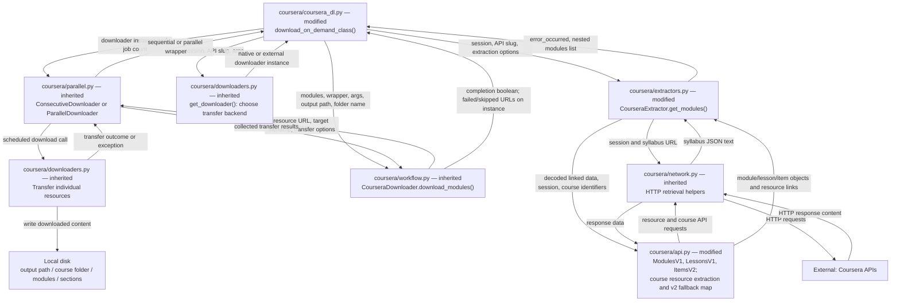
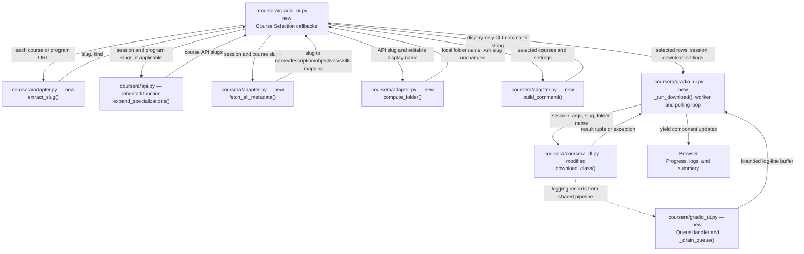

# September 29: Fork Contributions and Architecture

Retrospective implementation record, prepared October 1, 2026. The September 29 filename identifies the original planning discussion; the features below are already implemented, not proposed new work.

## Comparison and Scope

This record compares local historical baseline `10ba6b8` with fork commit `cc3d053`, not today's upstream branch. Preserve upstream attribution and license notices. Future improvements belong in a separate plan; this document does not propose replacing the existing Gradio interface.

| Area | Inherited functionality | Fork additions or modifications |
| --- | --- | --- |
| Interface | CLI launcher and downloader | `gradio_app.py`, three-tab `coursera/gradio_ui.py`, metadata previews, selection table, settings, command preview, logs, and cancel/reset controls |
| Adapter | CLI argument parsing | New `coursera/adapter.py`: URL parsing, UI argument construction, folder naming, metadata fetching, command rendering, and configuration loading |
| Authentication | Cookie support and legacy login | Shared `build_session()` in `coursera/coursera_dl.py`; cookie loading before API access; CSRF headers and modern cookie-file reading |
| Specializations | `--specialization` and API expansion | Interactive review, display-name folder overrides, and `-y` / `--yes` |
| Compatibility | Course extraction and utility functions | v2 material reuse in `coursera/api.py` and `coursera/extractors.py`; cookie-file fixes; `html.unescape` in `coursera/utils.py`; dependency adjustments |
| Tests and docs | Existing suite and README | Adapter and UI-helper tests; Gradio, authentication, and specialization documentation |

Flags such as `-c`, `--path`, and `--subtitle-language` already existed. The fork modifies authentication and specialization behavior; it does not originate those flags or specialization expansion.

## Reading the Diagrams

Each block names its source file and operation. Arrows name inputs, returned values, or side effects. **New**, **modified**, and **inherited** refer to the comparison above. Multiple blocks can represent different functions in the same file. External services and files on disk are not Python modules.

### 1. Entry Points, Authentication, and Shared Execution



Gradio calls Python functions directly; the command preview does not execute a CLI subprocess. The adapter constructs its own options, so shared execution does not imply identical defaults. Loading cookies creates a session; it does not itself prove that the credentials are accepted by Coursera.

### 2. Extraction, API Models, and Download Output

`extractors.py` and `api.py` are **separate modified files**. The extractor coordinates syllabus parsing; API classes represent course data and resolve resource links. File transfer and directory traversal reuse inherited modules.



The modules list contains module, section, and lecture structure with resource links; it is not the downloaded file content. The API slug identifies the remote course. The optional folder override changes only its local directory name. The core returns two booleans: syllabus parsing errors and apparent completion; it separately logs failed resource URLs.

### 3. Gradio Course Selection and Progress Feedback



The preview metadata is separate from the full syllabus used for downloads. Its `skills` field currently defaults to an empty list. Cancellation sets an event in the UI runner; it does not immediately interrupt a running downloader thread. Reset and rerun/resume controls exist, but their edge cases need separate verification. For CLI specializations, the added interactive review creates the same distinction between API slug and display-derived folder; `--yes` skips the prompts.

## Verification Record

- The maintainer reports successful manual use of both CLI downloads and Gradio. This is not an independent rerun or a claim that every option was tested.
- Added automated tests are in `coursera/test/test_adapter.py` and `coursera/test/test_gradio_helpers.py`. Their presence does not imply a passing test run during this documentation task.
- Certificate expansion, cancellation/resume edge cases, supported Python versions, and cross-platform behavior are not independently verified here.
- The inherited Dockerfile installs the upstream PyPI package rather than this checkout; its behavior is outside the manual verification above.

## Documentation Acceptance Checklist

- [x] Identify the historical Git comparison and distinguish additions from inherited behavior.
- [x] Name files, operations, inputs, and outputs in architecture diagrams.
- [x] Show shared authentication and download logic without implying subprocess execution or matching defaults.
- [x] Separate user-reported manual testing from automated verification.
- [ ] Visually preview Mermaid diagrams in a Markdown renderer with Mermaid support.

Future implementation work should extend the existing interface and remain in a separate improvement plan.

## CLI Usage and Argument Reference

Run commands from the repository root. The `coursera-dl` launcher calls `main()` in `coursera/coursera_dl.py`; arguments are defined in `coursera/commandline.py`.

### Download a Course

```powershell
uv run python .\coursera-dl -c .\cookies.txt --path ".\courses" --subtitle-language en introduction-to-ai-and-machine-learning-on-google-cloud
```

The final argument is the course slug: the part after `/learn/` in its URL. Supply multiple slugs separated by spaces to download several courses. `--path` is the parent output directory; each course gets a subfolder. Quote paths containing spaces.

### Common Options

| Argument | Purpose / example |
| --- | --- |
| `-c .\cookies.txt` | Load browser cookies for authentication |
| `--path ".\courses"` | Parent output directory |
| `--subtitle-language en` | English subtitles; also accepts `all` or `"en,hi"`; CLI default is `all` |
| `--video-resolution 720p` | Video quality: `360p`, `540p` (default), or `720p` |
| `--formats "mp4 pdf"` | Download selected file types; default is all |
| `--ignore-formats "srt,txt"` | Exclude comma-separated file extensions |
| `--jobs 4` | Parallel resource downloads; default is `1` |
| `--download-delay 10` | Seconds between courses; default is `60` |
| `--resume` | Resume incomplete downloads |
| `--overwrite` | Overwrite existing files |
| `--download-quizzes` | Include quiz/exam question content |
| `--download-notebooks` | Include notebook files |
| `--specialization` | Expand a specialization or professional-certificate slug into courses |
| `-y` / `--yes` | Skip specialization review prompts |
| `--debug` | Detailed diagnostic output |

### Download a Specialization or Professional Certificate's Courses

```powershell
uv run python .\coursera-dl -c .\cookies.txt --path ".\courses" --subtitle-language en --specialization preparing-for-google-cloud-machine-learning-engineer-professional-certificate
```

Use the program slug from its specialization or professional-certificate URL. This downloads course materials within the program, not an earned certificate PDF. Add `--yes` to skip interactive review. When reviewing display names, the API slug stays unchanged; the override affects the local folder name.

### Filter Selected Content

Append any applicable regular-expression filters to a download command:

```powershell
--section_filter "Week_1"
--lecture_filter "Introduction"
--resource_filter "slides"
```

These are argument fragments, not standalone commands. The long filter names use underscores. Their short forms are `-sf`, `-lf`, and `-rf` respectively.

### Additional Options

| Category | Flags |
| --- | --- |
| Inspection/debugging | `--only-syllabus`, `--cache-syllabus`, `--skip-download`, `--version` |
| Output organization | `--verbose-dirs`, `--unrestricted-filenames`, `--combined-section-lectures-nums`, `--playlist` |
| Ordering/logging | `--reverse`, `--quiet` |
| External downloaders | `--wget`, `--curl`, `--aria2`, `--axel`, `--downloader-arguments` |
| Advanced | `--preview`, `--about`, `--disable-url-skipping`, `--hook`, `--mathjax-cdn`, `--process_local_page` |
| Authentication/cache | `--cauth`, `--username`, `--password`, `--netrc`, `--keyring`, `--clear-cache` |

Legacy username/password, netrc, and keyring options remain in the parser; prefer the manually tested cookie-file workflow. `--list-courses` still follows the legacy login path. External downloader options require their corresponding programs to be available.

### Full Help and Verification Scope

```powershell
uv run python .\coursera-dl --help
```

The current help output was checked locally using `.\.venv\Scripts\python.exe .\coursera-dl --help`. This reference describes options exposed by the code; it does not establish successful runtime verification of every option. Some inspection options still retrieve data from the network.

## How Gradio Uses the CLI's Download Logic

Gradio does not construct and execute a shell command to start a download. It collects settings in the browser and calls the shared Python downloader directly.

```text
CLI:
coursera-dl -> commandline.parse_args() -> coursera_dl.main()
           -> download_class(session, args, slug, folder_name=...)

Gradio:
gradio_app.py -> gradio_ui.py -> adapter.make_args()
             -> download_class(session, args, slug, folder_name=...)
```
Running the app   `uv run python gradio_app.py` 
The CLI parser produces an argument namespace from command-line flags and configuration. Gradio's `adapter.make_args()` instead builds a `SimpleNamespace` from UI settings, containing the attributes the downloader expects: output path, subtitle language, resolution, formats, parallelism, and other options. The UI starts the download in a worker thread and streams logging output back to the browser.

Both paths use the shared `build_session()` authentication helper and `download_class()` pipeline. The CLI command displayed in Gradio is a copyable reference, not the command being executed. Because the UI constructs options separately, defaults can differ: the adapter defaults to English subtitles and a five-second inter-course delay, while the CLI defaults to all subtitle languages and a sixty-second delay. Do not assume that the preview proves complete CLI/UI equivalence.

## Creating and Using cookies.txt

`cookies.txt` is an export of your signed-in browser session. It is not a file of your Coursera username and password, and the downloader does not create a fresh authenticated session file for you. The examples use the filename `cookies.txt`; another filename works if you pass its correct path.

1. Sign in to Coursera in your browser and open a course you can access.
2. Use a browser cookie-export tool that supports **Netscape cookies.txt format**. Export cookies for Coursera, including applicable `.coursera.org` cookies; do not export cookies from unrelated sites. Browser-specific tool menus vary.
3. Save the export as `cookies.txt` in a private local location. For the examples below, place it in the repository root. A JSON export or a copied HTTP `Cookie:` header is not the expected format.
4. For CLI use, provide `-c .\cookies.txt`. In Gradio, upload that file in the Setup tab and use the cookie-loading/connect control.
5. If authentication stops working, confirm browser access and export a fresh file. A failure can also reflect course access or API behavior; an expired cookie is not the only possible cause.

A Netscape cookie file normally starts with `# Netscape HTTP Cookie File`. Its records are tab-separated fields for domain, subdomain inclusion, path, secure flag, expiration, cookie name, and cookie value. Let the exporter generate these records instead of constructing them manually. This code loads the cookie jar and, when present, copies the CSRF cookie into the `X-CSRF3-Token` request header.

```powershell
uv run python .\coursera-dl -c .\cookies.txt --path .\courses introduction-to-ai-and-machine-learning-on-google-cloud
```

Treat the export as a credential: someone with the session cookies may be able to access your account. Do not paste its contents into issues, screenshots, logs, or documentation. The repository ignores the standard `cookies.txt` name, but a renamed export may not be ignored. Keep exports private and never commit them. Gradio loading the file successfully confirms local parsing, not acceptance by the live Coursera API.

## Understanding Course and Program Slugs

A **slug** is the URL identifier for a course or program. It is usually lowercase with hyphens, but it is not necessarily the current displayed title. Copy it from the URL rather than deriving it by replacing spaces in a title.

| URL example | Slug | CLI usage |
| --- | --- | --- |
| `https://www.coursera.org/learn/introduction-to-ai-and-machine-learning-on-google-cloud` | `introduction-to-ai-and-machine-learning-on-google-cloud` | Pass as a positional course argument |
| `https://www.coursera.org/specializations/<program-slug>` | `<program-slug>` | Pass with `--specialization` |
| `https://www.coursera.org/professional-certificates/<certificate-slug>` | `<certificate-slug>` | Pass with `--specialization` |

Angle-bracket values are placeholders: replace them with the actual URL segment. For a course URL containing `/learn/<course-slug>/home/...`, use only the segment immediately after `/learn/`; omit later path segments, query strings such as `?utm_source=...`, and fragments after `#`.

The CLI examples expect slugs as positional arguments. Gradio's URL parser accepts supported Coursera URLs and extracts the slug and whether the input represents a course or program. A program slug identifies a collection: expansion resolves it into individual course API slugs before downloading.

Keep these three names distinct:

- **API slug:** the identifier passed to Coursera to retrieve a course.
- **Display name:** the readable title shown to the user; it can differ from the API slug.
- **Output folder:** the local directory name; it normally uses the API slug, or a display-derived name combined with the API slug when an override is supplied.

Changing a display name or folder does not change which course is requested. The fork deliberately preserves the API slug when building names such as `display-name_api-slug`. Renaming a folder therefore cannot fix an incorrect or inaccessible API course identifier.
